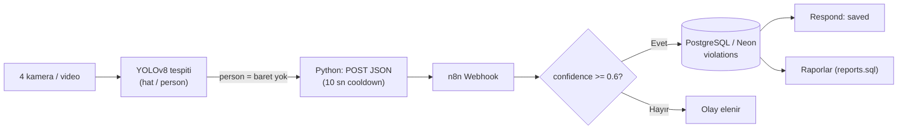
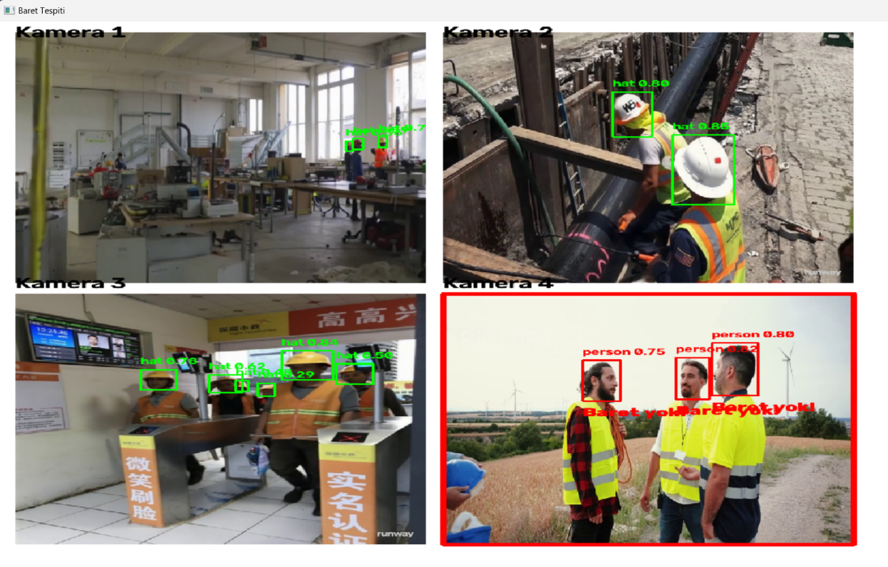
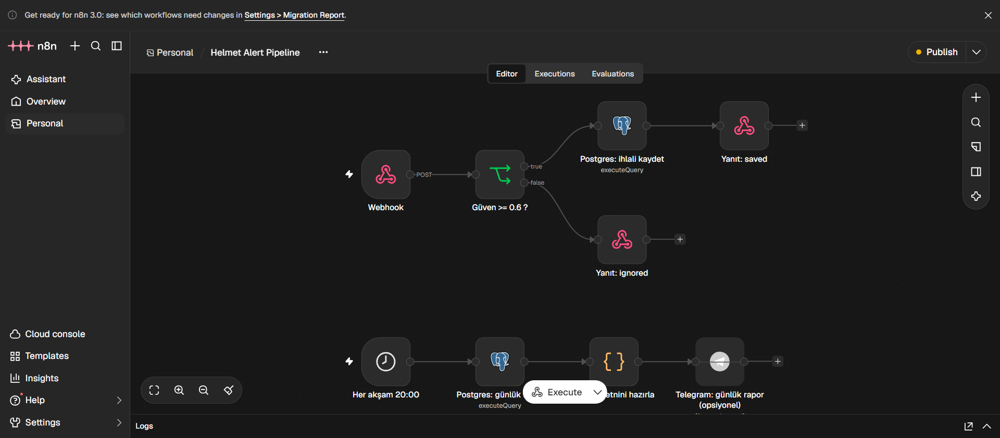
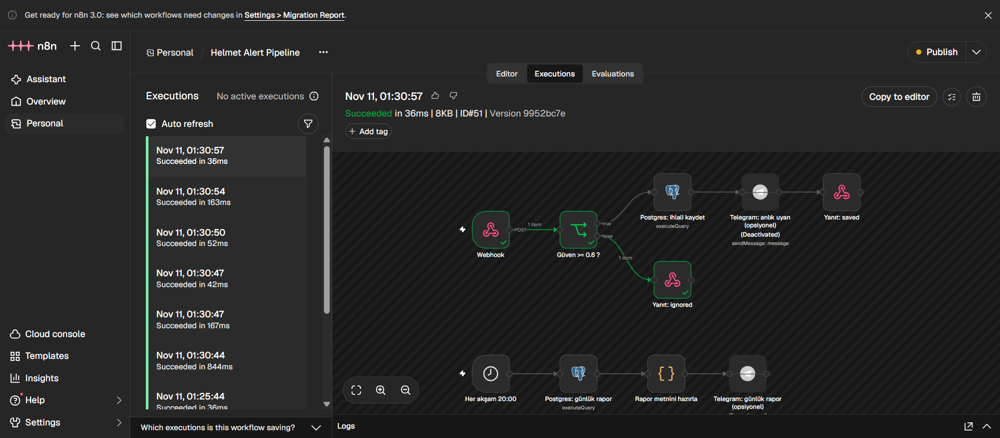
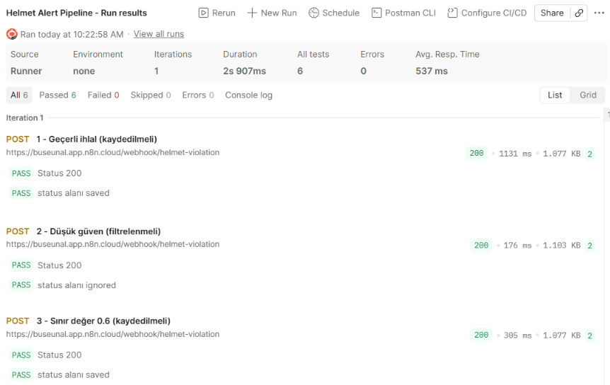
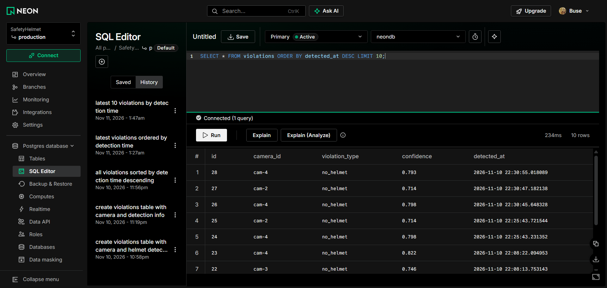
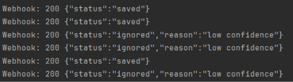

# YOLOv8 ile Baretsiz İnsan Tespiti

Şantiye kameralarında baret takmayan kişileri YOLOv8 ile gerçek zamanlı tespit edip ihlalleri **n8n webhook → PostgreSQL (Neon)** hattıyla kaydeden uçtan uca bir iş güvenliği projesi.

---

## 🔀 Akış Şeması



---

## ✨ Özellikler

- `hat` ve `person` sınıflarıyla baretli / baretsiz kişi ayrımı
- 4 kamerayı simüle eden 2x2 izleme ekranı; ihlal olan kamera kırmızı çerçeveyle işaretlenir
- GPU (CUDA) desteği ve 4 karenin tek seferde (batch) işlenmesi
- İhlal anında n8n webhook'una JSON olay gönderimi (kamera başına 10 sn cooldown, arka plan thread'i)
- n8n'de güven skoru filtresi ve PostgreSQL'e kayıt
- Hazır SQL rapor sorguları ve Postman test koleksiyonu
- Webhook adresi kodda değil, `.env` dosyasında

---

## 🧰 Kullanılan Teknolojiler

- Python, Ultralytics YOLOv8, OpenCV, PyTorch
- n8n (webhook otomasyonu)
- PostgreSQL (Neon)
- Postman (API testleri)

---

## 📂 Veri Seti ve Model

- Veri seti: [Safety Helmet Wearing Dataset – Roboflow](https://universe.roboflow.com/zayed-uddin-chowdhury-ghymx/safety-helmet-wearing-dataset)
- Model: `YOLOv8m`, 20 epoch, batch 16

| Sınıf   | Doğruluk (P) | Duyarlılık (R) | mAP@0.5 | mAP@0.5:0.95 |
|---------|--------------|----------------|---------|--------------|
| hat     | 0.928        | 0.871          | 0.928   | 0.691        |
| person  | 0.935        | 0.879          | 0.939   | 0.480        |
| **Tümü** | **0.932**   | **0.875**      | **0.934** | **0.586**  |

---

## ⚙️ Kurulum

```bash
git clone https://github.com/buseunal/YOLOv8-Ile-Baretsiz-Insan-Tespiti.git
cd YOLOv8-Ile-Baretsiz-Insan-Tespiti
python -m venv .venv
.venv\Scripts\activate          # Linux/macOS: source .venv/bin/activate
pip install -r requirements.txt
```

**GPU (önerilir):** NVIDIA kartınız varsa PyTorch'un CUDA sürümünü kurun, aksi halde tespit CPU'da çok yavaş çalışır:

```bash
pip install torch torchvision --index-url https://download.pytorch.org/whl/cu130
```

**Model dosyası:** `models/best.pt` Git LFS ile saklanır. Repoyu ZIP olarak indirirseniz bu dosya 133 baytlık bir işaretçi olarak gelir. Bunun yerine:

```bash
git lfs install
git lfs pull
```

ya da GitHub'da `models/best.pt` → **Download raw file**.

**Ortam değişkenleri:**

```bash
copy .env.example .env          # Linux/macOS: cp .env.example .env
```

`.env` içindeki `WEBHOOK_URL` değerini kendi n8n webhook adresinizle değiştirin. Boş bırakılırsa tespit çalışır ama bildirim gönderilmez.

---

## 🗄️ n8n ve Veritabanı Kurulumu

1. **Veritabanı:** [Neon](https://neon.tech) (veya herhangi bir PostgreSQL) üzerinde `n8n/schema.sql` dosyasını çalıştırarak `violations` tablosunu oluşturun.
2. **Workflow:** n8n'de *Import from File* ile `n8n/n8n_workflow.json` dosyasını içe aktarın.
3. **Credential:** Postgres düğümlerine kendi veritabanı bilgilerinizle bir credential bağlayın (dosyada credential bulunmaz).
4. **Test:** `n8n/postman_collection.json` dosyasını Postman'a aktarıp istekleri çalıştırın.
5. Workflow'u **Active** yapın ve üretim URL'sini (`/webhook/...`) `.env` dosyasına yazın.
6. Raporlar için `n8n/reports.sql` içindeki sorguları kullanın (kamera başına ihlal, saatlik dağılım, son ihlaller, ortalama güven).

Gönderilen olay formatı:

```json
{ "camera_id": "cam-1", "violation_type": "no_helmet", "confidence": 0.87 }
```

---

## ▶️ Çalıştırma

Proje klasörüne `deneme.mp4`, `deneme2.mp4`, `deneme3.mp4`, `deneme4.mp4` adlı dört video koyun (videolar repoda yer almaz), ardından:

```bash
python train_yolo.py
```

Çıkmak için pencerede **q** tuşuna basın. Başarılı bir bildirimde terminalde `Webhook: 200 {"status":"saved"}` görülür.

---

## 🖼️ Ekran Görüntüleri

| | |
|---|---|
|  |  |
| Dört kameralı ekran, kırmızı çerçeveli ihlal | n8n akışının genel görünümü |
|  |  |
| n8n Executions — başarılı çalışmalar | Postman yanıtları ve Test Results |
|  |  |
| Neon'daki `violations` tablosu | Terminalde `Webhook: 200` çıktısı |

Model çıktılarından örnekler:

<p align="center">
  
  
</p>
<p align="center">
  
  
</p>

---

## 📁 Proje Yapısı

```
├── train_yolo.py            # Tespit + webhook bildirimi
├── data.yaml                # Eğitim veri seti tanımı
├── requirements.txt
├── .env.example             # WEBHOOK_URL şablonu
├── models/
│   └── best.pt              # Eğitilmiş YOLOv8m ağırlıkları (Git LFS)
├── n8n/
│   ├── n8n_workflow.json    # n8n akışı
│   ├── schema.sql           # violations tablosu
│   ├── reports.sql          # Rapor sorguları
│   └── postman_collection.json
├── results/                 # Örnek tespit görüntüleri
└── docs/images/             # README ekran görüntüleri
```

---

## 🚧 Sınırlamalar ve Geliştirme Fikirleri

- "Baretsiz" kararı yalnızca `person` sınıfına dayanıyor; kişi–baret eşleştirmesi (IoU tabanlı) eklenebilir.
- Videolar dosyadan okunuyor; RTSP / IP kamera desteği eklenebilir.
- `mAP@0.5:0.95` değeri `person` sınıfında düşük (0.48); daha fazla veri ve epoch ile iyileştirilebilir.
- Webhook'a kimlik doğrulama (header token) eklenmeli.
- Kayıt sırasında ihlal anının görüntüsü de saklanabilir (S3 vb.).
- Telegram / e-posta bildirimleri ve bir dashboard (Grafana, Metabase) eklenebilir.
