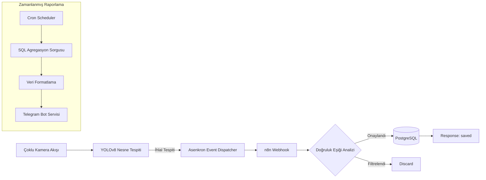
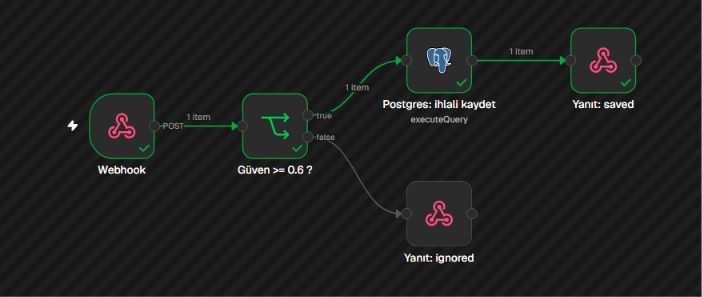
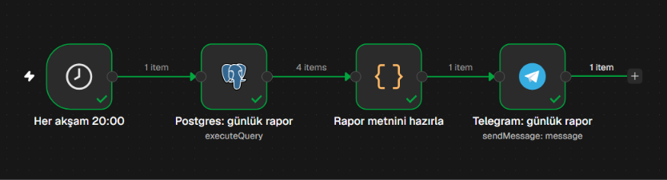
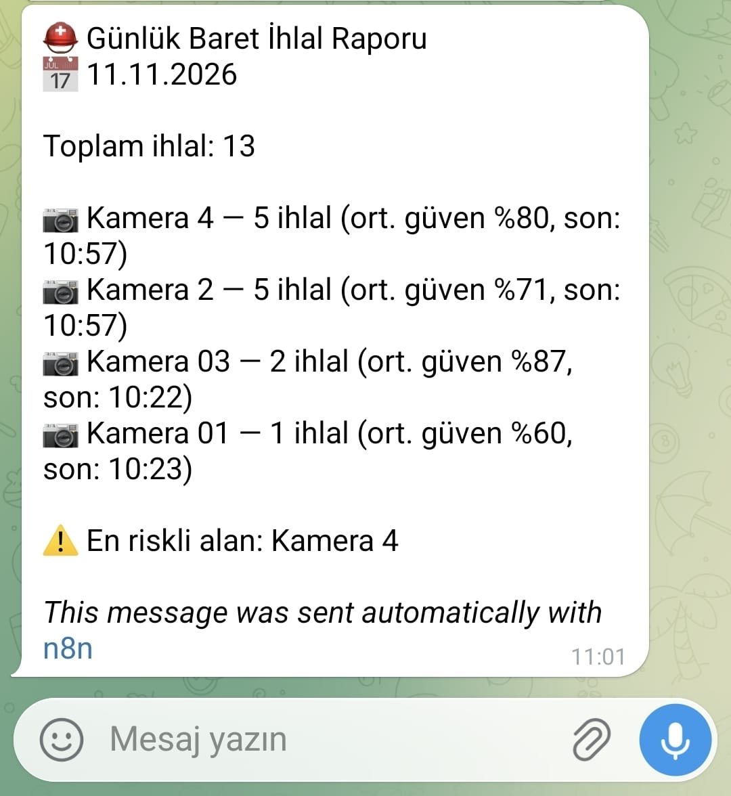

# YOLOv8 ile Baretsiz İnsan Tespiti

Şantiye ve çalışma sahalarında baret takmayan personeli YOLOv8 ile eşzamanlı tespit eden, tespit edilen kural ihlallerini webhook mimarisi üzerinden PostgreSQL veri tabanına kaydeden ve Telegram üzerinden zamanlanmış raporlama sunan uçtan uca iş güvenliği denetim sistemi.

---

## Mimari Akış



---

## Temel Özellikler

- **Çoklu Sınıf Analizi:** `hat` ve `person` sınıfları üzerinden baretli ve baretsiz ayrımı
- **Eşzamanlı Çoklu Akış Desteği:** 4 ayrı kamera kaynağının tek ekranda izlenmesi ve ihlal anında ilgili kaynağın dinamik olarak işaretlenmesi
- **Yüksek Performanslı Çıkarım:** Batch processing ve CUDA hızlandırması ile optimize edilmiş gerçek zamanlı tespit
- **Asenkron Event Bildirimi:** Ana döngüyü bloklamayan, cooldown mekanizmasına sahip asenkron bildirim mimarisi
- **Doğrulama ve Filtreleme Hattı:** n8n üzerinde belirlenen güven skoru eşiğine göre filtreleme ve veri tabanı kayıt yönetimi
- **Otomatik Vardiya / Gün Sonu Raporu:** Belirlenen periyotlarda saha ihlal istatistiklerini derleyip ileten Telegram entegrasyonu
- **Hazır Test ve Raporlama Paketi:** Postman test koleksiyonu ve analitik SQL sorguları
- **Güvenli Yapılandırma:** Hassas bağlantı adreslerinin `.env` üzerinden yönetimi

---

## Teknoloji Yığını

- **Görüntü İşleme ve Derin Öğrenme:** Python, Ultralytics YOLOv8, OpenCV, PyTorch (CUDA)
- **Entegrasyon ve İş Akışı:** n8n
- **Veri Tabanı:** PostgreSQL (Neon Serverless Postgres)
- **Bildirim ve Raporlama Servisi:** Telegram Bot API
- **API Test ve Doğrulama:** Postman

---

## Veri Seti ve Model Başarımı

Model eğitimi [Roboflow Safety Helmet Wearing Dataset](https://universe.roboflow.com/zayed-uddin-chowdhury-ghymx/safety-helmet-wearing-dataset) kullanılarak YOLOv8m mimarisi üzerinde gerçekleştirilmiştir.

| Sınıf | Doğruluk (Precision) | Duyarlılık (Recall) | mAP@0.5 | mAP@0.5:0.95 |
|---|---|---|---|---|
| hat | 0.928 | 0.871 | 0.928 | 0.691 |
| person | 0.935 | 0.879 | 0.939 | 0.480 |
| **Genel** | **0.932** | **0.875** | **0.934** | **0.586** |

---

## Kurulum ve Çalıştırma

### 1. Ortam Hazırlığı

```bash
git clone https://github.com/buseunal/YOLOv8-Ile-Baretsiz-Insan-Tespiti.git
cd YOLOv8-Ile-Baretsiz-Insan-Tespiti
python -m venv .venv
source .venv/bin/activate  # Windows: .venv\Scripts\activate
pip install -r requirements.txt
```

NVIDIA GPU desteği için ortama uygun CUDA derlemesini yükleyin:

```bash
pip install torch torchvision --index-url https://download.pytorch.org/whl/cu130
```

### 2. Model Ağırlıkları

Model dosyası `models/best.pt` Git LFS üzerinden yönetilmektedir:

```bash
git lfs install
git lfs pull
```

### 3. Yapılandırma

Ortam değişkenlerini yapılandırmak için `.env` dosyasını oluşturun:

```bash
cp .env.example .env  # Windows: copy .env.example .env
```

`.env` içeriğindeki `WEBHOOK_URL` parametresine n8n webhook adresinizi tanımlayın.

### 4. n8n ve Veri Tabanı Konfigürasyonu

1. `n8n/schema.sql` dosyasını PostgreSQL üzerinde çalıştırarak `violations` tablosunu hazırlayın.
2. `n8n/n8n_workflow.json` akışını n8n arayüzünden içe aktarın.
3. PostgreSQL ve Telegram servis bağlantılarınızı tanımlayın.
4. `n8n/postman_collection.json` dosyasını kullanarak uçtan uca testleri gerçekleştirin.
5. Akışı aktif hale getirin.

Olay yükü (Event Payload) yapısı:

```json
{
  "camera_id": "cam-1",
  "violation_type": "no_helmet",
  "confidence": 0.87
}
```

### 5. Uygulamayı Başlatma

```bash
python train_yolo.py
```

---

## Sistem Görselleri

| | |
|---|---|
|  |  |
| Eşzamanlı çoklu kamera izleme paneli ve ihlal tespiti | n8n olay işleme ve bildirim iş akışı |
|  |  |
| Doğrulanmış ihlal kaydı yürütme detayı | Gün sonu özet sorgulama ve Telegram tetikleme hattı |
|  |  |
| Postman entegrasyon test sonuçları | Webhook olay iletim çıktıları |
|  |  |
| PostgreSQL ihlal kayıtları tablosu | Saha bazlı periyodik özet rapor çıktısı |

Örnek tespit çıktıları:

<p align="center">
  
  
</p>
<p align="center">
  
  
</p>

---

## Proje Dizini

```
├── train_yolo.py            # Nesne tespiti ve olay iletim modülü
├── data.yaml                # Veri seti yapılandırması
├── requirements.txt         # Bağımlılık listesi
├── .env.example             # Çevre değişkenleri şablonu
├── models/
│   └── best.pt              # YOLOv8m model ağırlıkları (Git LFS)
├── n8n/
│   ├── n8n_workflow.json    # Entegrasyon akışı tanımı
│   ├── schema.sql           # Tablo şema tanımı
│   ├── reports.sql          # Analitik SQL sorguları
│   └── postman_collection.json # API test paketi
├── results/                 # Örnek çıkarım sonuçları
└── docs/images/             # Dokümantasyon görselleri
```
